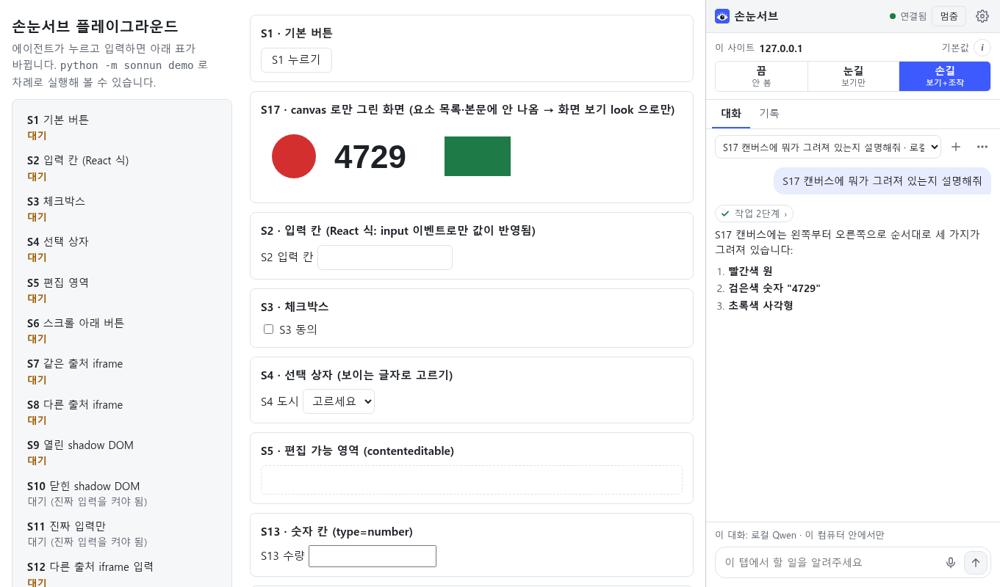
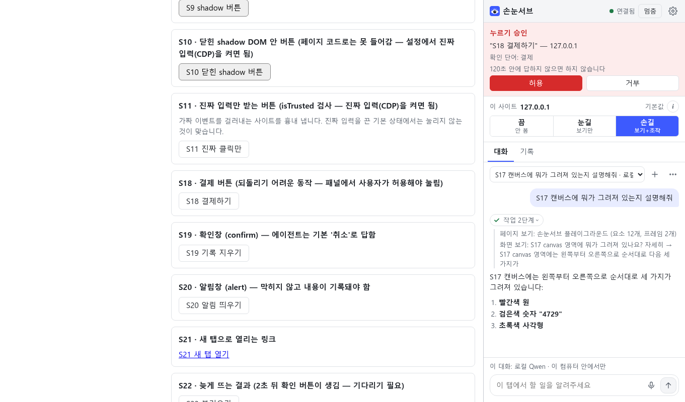
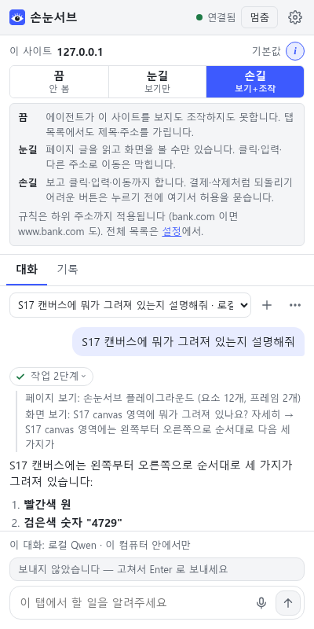
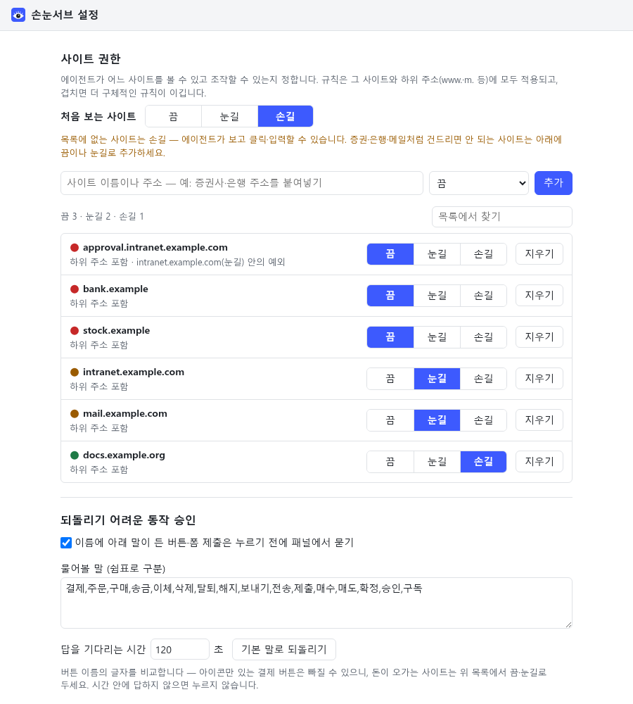
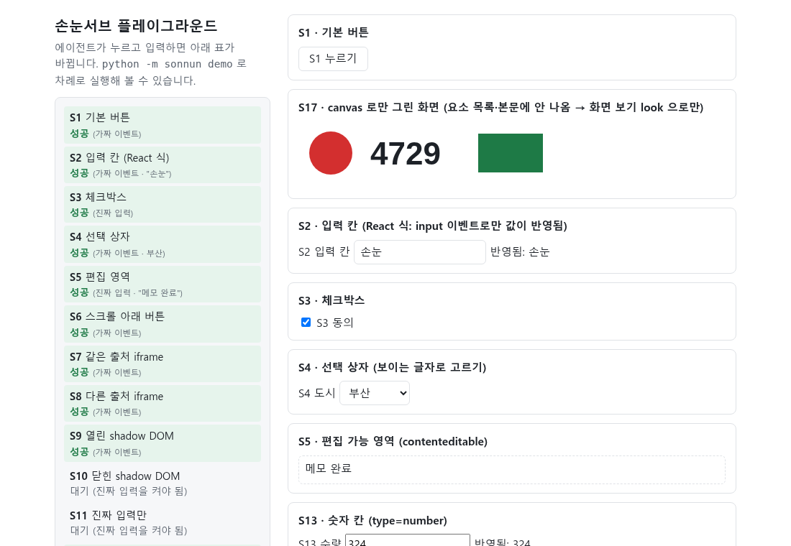

# browser_agent — 손눈서브

> 에이전트가 **내 Chrome** 을 보고(눈) 조작합니다(손) — **Claude 로도, 로컬 sLLM 으로도** (로컬이면 폐쇄망에서도). 🎤 음성으로도 시킬 수 있습니다.

**손눈서브**는 에이전트의 **손**과 **눈**이 되어 **준다(serve)** 는 뜻이고, 소리는 **속눈썹** — 눈 바로 옆에 붙어 있는 것 — 에서 왔습니다.
서버를 켜는 명령 `sonnun serve` 를 읽으면 그대로 "손눈서브"입니다.

*Eyes and hands for a local agent in your own Chrome: a Chrome extension plus a small local server give any model
(a local LLM, Claude Code, or your own Python) tools to read and operate the pages you are logged in to — with per-site
permissions, approval for irreversible clicks, and no page content leaving the machine when you use a local model.*



## 할 수 있는 것

- **두뇌를 고릅니다 — Claude 로도, 로컬 sLLM 으로도.** 사이드 패널에서 대화할 때 세션을 고릅니다.
  - **로컬 sLLM**: vLLM 같은 OpenAI 호환 서버의 모델 (기본 Qwen3.8-27B INT4, 8k 컨텍스트에 맞춤) + [basic_agent](https://github.com/Taeksu-Kim/basic_agent). 페이지 내용이 이 컴퓨터 밖으로 나가지 않아 **폐쇄망에서도** 됩니다.
  - **Claude Code**: 같은 도구를 MCP 로 붙입니다 (이 세션을 고르면 보는 페이지 내용이 Anthropic 으로 갑니다 — 패널에 표시).
  - **내 코드·다른 에이전트**: `import`, CLI, 아무 MCP 클라이언트에서 같은 도구를 씁니다.
- **내 Chrome 을 그대로 씁니다.** 새 브라우저가 아니라 로그인·쿠키가 있는 지금 Chrome 의 탭을 봅니다.
- **보기(눈)**: 누를 수 있는 요소와 본문, iframe·shadow DOM 안까지. 글로 안 잡히는 canvas·차트·아이콘은 **화면을 그림으로 보고**(비전 모델) 답합니다.
- **조작(손)**: 클릭·입력·키·마우스 올리기·스크롤·탭 이동. 가짜 이벤트를 거르는 사이트는 **진짜 입력**(브라우저 자체 입력)으로.
- **안전 장치**: 사이트별 권한(끔·눈길·손길), 결제·삭제 같은 버튼은 **누르기 전에 허용을 묻기**, 전체 멈춤, 일을 시킨 탭에서만 움직이기.
- **음성 입력**: 🎤 를 누르고 말하면, 말을 멈출 때 알아서 끝나고 글로 바뀝니다 — Google 음성 인식 또는 **Whisper(이 컴퓨터 안)**.
- **스크립트로 내보내기**: 에이전트가 한 번 해 본 일을 다시 실행하는 Python 스크립트로 (탐색은 에이전트로, 반복은 스크립트로).
- **플레이그라운드**: 어떤 화면에서 무엇이 되는지 눈으로 확인하는 시나리오 24개.

처음 쓰신다면 **[사용 설명서](docs/USAGE.md)** 를 따라 하세요 (설치부터 첫 지시, 권한, 음성, 문제 해결까지 화면과 함께).

손눈서브는 **판단하지 않습니다.** 보기·조작 도구와 안전 장치만 맡고, 무엇을 할지는 고른 두뇌가 정합니다.

| | 손눈서브 | 브라우저 자동화 (Playwright 등) | 클라우드 브라우저 에이전트 |
|---|---|---|---|
| 브라우저 | **내 Chrome** (로그인·쿠키 그대로) | 새 브라우저 (로그인 다시) | 내 Chrome |
| 모델 | 고름 (로컬 가능) | 없음 (코드) | 정해진 클라우드 모델 |
| 폐쇄망 | **됨** (로컬 모델) | 됨 | 안 됨 |

```
 Chrome (내 프로필·로그인 그대로)                         로컬 서버  sonnun serve  (127.0.0.1:8771)
 ┌──────────────────────────────────────┐  WebSocket  ┌──────────────────────────────────────────────┐
 │ 확장 background.js                    │◀──────────▶│ bridge → service.run_tool (활동 기록·중지)      │
 │  · 눈/손 동작 실행                     │  명령/결과   │   ▲            ▲                ▲              │
 │  · 마지막 관문: 사이트 권한·멈춤·승인    │             │ 로컬 LLM 턴    Claude Code 턴    import / CLI    │
 │ 사이드 패널: 승인 / 권한 / 대화 / 기록   │──HTTP─────▶│ (basic_agent)  (mcp_bridge)     (client.py)    │
 └──────────────────────────────────────┘             └──────────────────────────────────────────────┘
```

## 빠른 시작

자세한 순서와 화면은 [사용 설명서](docs/USAGE.md).

Python 3.10 이상, Chrome(또는 Chromium 계열).

```bash
git clone https://github.com/Taeksu-Kim/basic_agent        # 로컬 LLM 대화를 쓸 때 (이 저장소 옆에, 또는 BASIC_AGENT_PATH)
git clone https://github.com/Taeksu-Kim/browser_agent && cd browser_agent
python -m pip install -e .
sonnun serve                                               # http://127.0.0.1:8771 (이 PC 안에서만 열림)
```

1. **확장 올리기** (스토어 없이, 인터넷 없이): `chrome://extensions` → 오른쪽 위 **개발자 모드** → **압축해제된 확장 프로그램 로드** →
   이 저장소의 `extension` 폴더. 파일을 바꾼 뒤에는 같은 화면에서 **새로고침(↻)**.
2. 툴바의 손눈서브 아이콘 → **사이드 패널**. 오른쪽 위가 **연결됨**이면 준비 끝.
3. **두뇌 켜기**: 로컬 sLLM 은 OpenAI 호환 서버를 켭니다 (`SONNUN_LLM_URL`, 기본 `http://<이 PC>:8002/v1` · `SONNUN_LLM_MODEL`,
   vLLM 예시는 [사용 설명서](docs/USAGE.md#2-두뇌-켜기)). Claude Code 세션은 `claude` CLI 가 설치·로그인돼 있으면 켜집니다.
   꺼져 있는 쪽은 패널에서 그 선택지만 잠기고 이유가 보입니다.

- 서버 주소·사이트 권한 목록·승인·진짜 입력·음성은 **설정 화면** (패널 ⚙, 또는 확장 아이콘 우클릭 → 옵션).
- WSL 에서 서버를, Windows 에서 Chrome 을 쓸 때는 WSL `networkingMode=mirrored` 에서 127.0.0.1 로 바로 붙었습니다.
- 대화·활동 기록은 `data/sonnun.db` (SQLite, `--data` 로 바꿈).

## 쓰는 방법 (창구 넷 — 도구·권한·승인·기록은 모두 같음)

| 창구 | 방법 |
|---|---|
| 사이드 패널 대화 | 세션 고르기 — **로컬 LLM** (기본) / **Claude Code**. 🎤 로 말해도 됨 |
| CLI | `sonnun run "이 페이지 요약해줘" [--backend claude]` — 패널 대화 목록에도 보임 |
| import | `from sonnun.client import Sonnun; b = Sonnun(); b.get_page(); b.click(ref="12")` |
| MCP | `python -m sonnun.mcp_bridge --url http://127.0.0.1:8771` 를 MCP 클라이언트에 stdio 서버로 등록 |

그 밖에: `sonnun demo` (플레이그라운드 시연) · `sonnun export` (대화를 스크립트로).

## 도구 16종

| 눈 (보기) | 손 (조작) | 사람 |
|---|---|---|
| `list_tabs` · `get_page` 화면 근처 요소(ref)·본문 앞부분 (+ 화면 밖 요소 이름) · `find` 이름으로 페이지 전체에서 · `read_text` 본문 이어 읽기 · `get_selection` 드래그한 글 · `look` 화면을 그림으로 보고 질문 · `wait_for` 글자가 나타날(사라질) 때까지 | `navigate` · `click` · `type_text` · `press_key` · `hover` · `scroll` · `go_back` · `switch_tab` | `ask_user` CAPTCHA·로그인·인증처럼 사람이 할 일을 패널로 부탁하고 기다림 |

- **iframe**(같은·다른 출처)과 **열린 shadow DOM** 안도 봅니다. iframe 은 프레임마다 그 사이트의 권한을 따로 봅니다.
- 모델에게는 페이지를 `[12] button 검색` 처럼 한 줄에 요소 하나로 보여 줍니다 (작은 로컬 모델 컨텍스트용).
- ref 는 브라우저 전체에서 겹치지 않아서, 페이지가 바뀐 뒤 옛 ref 로 다른 요소를 누르는 일이 없습니다.
- **작업 탭**: 대화는 보낸 탭에 묶입니다. 일을 시켜 두고 다른 탭으로 옮겨도 에이전트는 그 탭에서만 움직입니다.
- **알림창**: 에이전트가 누른 직후 뜨는 alert·confirm 은 탭을 멈추지 않고 기록해 돌려줍니다 (확인창은 기본 '취소').
- 비밀번호 칸은 입력을 거부하고 값도 보여 주지 않습니다.

## 안전 장치

| 장치 | 내용 |
|---|---|
| **사이트 권한** | **끔**(보지도 못함, 탭 목록에서도 가림) / **눈길**(보기만) / **손길**(보기+조작). 처음 보는 사이트는 기본 손길. 규칙은 하위 주소까지 적용되고 겹치면 더 구체적인 규칙이 이깁니다 (`company.com`=눈길 + `approval.company.com`=끔) |
| **승인** | 이름에 결제·주문·송금·삭제 같은 말이 든 버튼·폼 제출은 패널에서 **허용**해야 실행. 거부하거나 시간 안에 답이 없으면 하지 않음 |
| **사람에게 넘기기** | `ask_user` 카드 — "다 했어요" / "못 해요" |
| **멈춤** | 모든 창구의 모든 동작을 즉시 거부 |



<p>


</p>

- 검사는 모두 **확장이 실제 동작 직전에** 합니다 — 어느 창구에서 명령이 와도 같은 관문. 에이전트가 권한·승인 설정을 바꾸는 도구는 없습니다.
- 승인은 버튼 이름의 글자를 비교합니다. 아이콘만 있는 결제 버튼은 빠질 수 있으니, 돈이 오가는 사이트는 끔·눈길로 두세요.
- 페이지 안의 글은 지시가 아니라 자료로 다루도록 에이전트 지침(`assistant/GUIDE.md`)에 적혀 있습니다 (실모델 과제로 확인).

## 음성 입력 (패널 🎤)

누르고 말하면 **말을 멈출 때 알아서 끝나고** 글로 바뀝니다. 설정 화면에서 엔진과 모드를 고릅니다.

| 엔진 | 어디서 | 필요한 것 |
|---|---|---|
| **Google 음성 인식** (기본) | Chrome 내장 Web Speech API — 내 말이 Google 로 감 (페이지 내용은 안 감) | 인터넷. 무료·키 없음 |
| **Whisper** | 이 컴퓨터 안 — 패널이 녹음하고 0.8초 조용하면 끝, `/api/stt` → 음성 서버 | `pip install -e .[stt]` 후 `python tools/stt_server.py` (GPU 약 1.5GB, `--device cpu` 도 됨) |

말을 멈춘 뒤: **잠깐 보여 주고 보내기**(기본 1.5초 — 그사이 입력창을 누르거나 Esc 면 안 보냄) / **바로 보내기** / **입력창에만**.
사이드 패널은 Chrome 이 마이크 허용 창을 띄우지 못해서, 처음 한 번은 설정 화면에서 허용합니다. 녹음은 저장하지 않습니다.

## 화면 보기 · 진짜 입력 · 스크립트

- **`look`**: 보이는 화면을 캡처해 로컬 **비전 모델**에 질문하고 답 글만 돌려줍니다 (canvas·차트·아이콘 버튼용). 이미지는 저장하지 않습니다.
  vLLM 이면 `--limit-mm-per-prompt '{"image":1,"video":0}'` 로 이미지 입력을 켭니다.
- **진짜 입력 (CDP, 기본 꺼짐)**: 켜면 `chrome.debugger` 로 브라우저 자체 입력(`isTrusted=true`)을 보냅니다. 가짜 이벤트를 거르는 사이트,
  닫힌 shadow DOM 용. 쓰는 동안 Chrome 위에 "디버깅 중" 띠가 뜹니다.
- **스크립트로 내보내기**: 대화에서 성공한 조작만 골라, 요소 **이름**으로 다시 실행하는 Python 스크립트로 (`sonnun export --format sonnun|playwright`).
  탐색은 에이전트로, 반복은 스크립트로.

## 플레이그라운드

서버가 `http://127.0.0.1:8771/playground/` 에 시나리오 24개짜리 테스트 페이지를 띄웁니다. 에이전트가 누르거나 입력하면 왼쪽 점수판이 바뀝니다.
`sonnun demo` 는 모델 없이 코드로 시나리오를 차례로 실행해 도구가 어디까지 되는지 보여 줍니다.



React 식 입력 칸, 서식 붙는 금액 칸, 다른 출처 iframe, shadow DOM, canvas, 결제 버튼(승인), 확인창·알림창, 새 탭, 늦게 뜨는 버튼,
마우스를 올려야 펼쳐지는 메뉴, Esc 로 닫는 창 등. 닫힌 shadow DOM(S10)·진짜 입력만 받는 버튼(S11)은 진짜 입력을 켜야 됩니다.

## 한계

- 진짜 입력을 끈 기본 상태의 클릭·입력은 페이지 안에서 만든 이벤트라, 이를 거르는 사이트에서는 안 먹습니다 → 진짜 입력.
- 다른 출처 iframe 안은 진짜 입력을 켜도 가짜 이벤트. canvas 는 `look` 으로 보기만 (좌표로 누르기 없음). 파일 올리기·내려받기 없음.
- 로컬 모델 컨텍스트 8k 기준으로 맞춰 두었습니다 (페이지 관측 2,000자, 최근 2개만 유지, 단계 상한 10).
- 브라우저는 하나라서 대화 턴은 한 번에 하나.
- 검증은 대부분 테스트 페이지에서 했습니다. 실제 사이트마다 막히는 곳이 있을 수 있습니다.

## 검증

| 점검 | 결과 (2026-11-16) |
|---|---|
| `tools/browser_check.py` — 실제 Chromium 에 확장을 올리고 테스트 페이지·가짜 모델로 전 경로 | **172/172** |
| `tools/real_local_check.py` — 로컬 Qwen3.8-27B-INT4 실모델 과제 (홀드아웃 4개 포함, 판정은 브라우저 상태로) | **19/19** (1회씩) |
| `tools/voice_check.py` — 진짜 Whisper 경로 (TTS 로 만든 말) | 3문장 중 2개 글자까지 같음 |
| `browser_check.py --real-claude` — Claude Code 세션 2턴 | 통과 ($0.10) |

과제별 내용, 처음에 잘못된 이유로 통과했던 과제를 고친 경과는 [docs/VERIFICATION.md](docs/VERIFICATION.md).

## 파일

| 경로 | 내용 |
|---|---|
| `extension/` | MV3 확장: `background.js` (연결·권한·승인·동작·CDP), `shared.js` (설정 기본값·권한 규칙), `sidepanel.*` (패널), `options.*` (설정 화면), `md.js` (답 마크다운 — 모든 글자를 먼저 이스케이프), `dialogs.js` (알림창), `mic-worklet.js` (Whisper 녹음) |
| `sonnun/` | 서버 (`app.py`), 상태의 주인 (`service.py`·`store.py`), 도구 정의 (`tools.py`), 세션 2종 (`chat.py`), 모델·비전·음성 연결 (`llm.py`·`vision.py`·`stt.py`), MCP 다리, import 클라이언트, 내보내기, 플레이그라운드 |
| `assistant/GUIDE.md` | 두 세션이 같이 쓰는 도우미 지침 |
| `tools/` | 점검 (`browser_check.py`·`real_local_check.py`·`voice_check.py`), 음성 서버 (`stt_server.py`), 캡처 (`screenshots.py`), 아이콘 (`make_icons.py`) |

## 라이선스

[Apache License 2.0](LICENSE). 함께 쓰는 소프트웨어와 외부 서비스는 [NOTICE](NOTICE).
"Chrome" 은 Google LLC, "Claude" 는 Anthropic PBC 의 상표이며, 이 프로젝트는 두 회사와 관련이 없습니다.
