# 사용 설명서

설치부터 첫 지시, 권한, 음성 입력, 문제 해결까지 순서대로. 화면은 모두 실제 확장·서버·로컬 모델로 찍은 것입니다 (`tools/screenshots.py`).

- [1. 설치](#1-설치)
- [2. 두뇌 켜기](#2-두뇌-켜기) — 로컬 sLLM / Claude Code
- [3. 확장 올리기](#3-확장-올리기)
- [4. 패널 열고 첫 지시](#4-패널-열고-첫-지시)
- [5. 잘 되는 지시 예시](#5-잘-되는-지시-예시)
- [6. 사이트 권한 정하기](#6-사이트-권한-정하기)
- [7. 승인 카드와 사람에게 넘기기](#7-승인-카드와-사람에게-넘기기)
- [8. 음성 입력](#8-음성-입력)
- [9. 그 밖의 기능](#9-그-밖의-기능) — 진짜 입력 · 스크립트 · 플레이그라운드 · CLI·MCP
- [10. 문제 해결](#10-문제-해결)

## 1. 설치

Python 3.10 이상, Chrome(또는 Chromium 계열).

```bash
git clone https://github.com/Taeksu-Kim/basic_agent        # 로컬 sLLM 대화에 씀 (이 저장소 옆에, 또는 BASIC_AGENT_PATH)
git clone https://github.com/Taeksu-Kim/browser_agent && cd browser_agent
python -m pip install -e .
sonnun serve                                               # http://127.0.0.1:8771 — 이 PC 안에서만 열림
```

`sonnun serve` 는 켜 둔 채로 둡니다. 대화·활동 기록은 `data/sonnun.db` 에 쌓입니다.

## 2. 두뇌 켜기

둘 중 하나만 있어도 됩니다. 꺼진 쪽은 패널에서 선택지만 잠기고 이유가 보입니다.

**로컬 sLLM** — OpenAI 호환 서버면 됩니다. 시험한 것은 vLLM 의 Qwen3.8-27B INT4 (8k 컨텍스트) 입니다.

```bash
vllm serve <모델 경로> --served-model-name qwen3.8-27b-redhat-int4 --port 8002 \
  --max-model-len 8192 --reasoning-parser qwen3 \
  --limit-mm-per-prompt '{"image":1,"video":0}' --mm-processor-kwargs '{"max_pixels": 802816}'   # 화면 보기(look)용 이미지 입력

SONNUN_LLM_URL=http://127.0.0.1:8002/v1 SONNUN_LLM_MODEL=qwen3.8-27b-redhat-int4 sonnun serve
```

- 이미지 입력을 켜지 않으면 화면 보기(`look`)만 안 되고 나머지는 됩니다.
- 손눈서브는 요청마다 생각 모드(thinking)를 끕니다. 페이지는 한 줄에 요소 하나로 줄여 보여 줘서 8k 안에서 돕니다.

**Claude Code** — `claude` CLI 가 설치·로그인돼 있으면 패널에서 고를 수 있습니다. 이 세션을 고르면 보는 페이지 내용이 Anthropic 으로 갑니다.

## 3. 확장 올리기

웹 스토어 없이, 인터넷 없이 올립니다.

1. 주소창에 `chrome://extensions`
2. 오른쪽 위 **개발자 모드**(Developer mode) 켜기
3. **압축해제된 확장 프로그램 로드**(Load unpacked) → 저장소의 `extension` 폴더

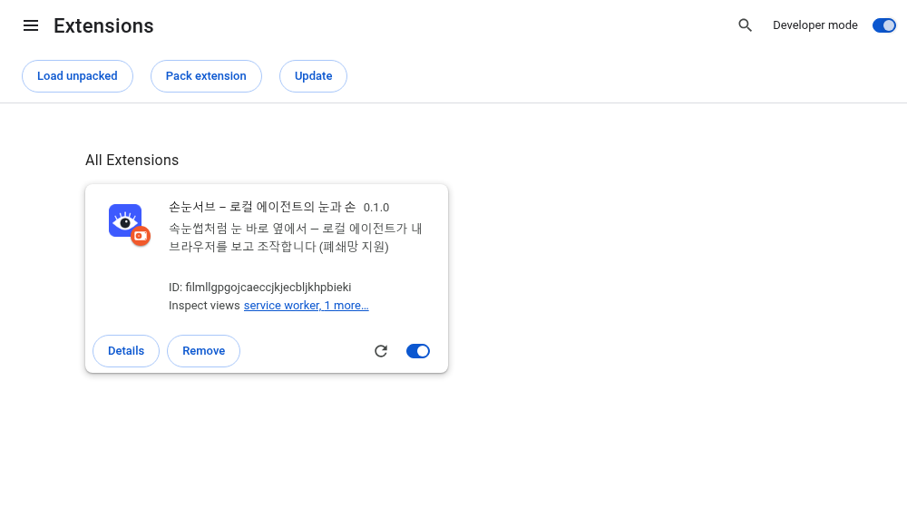

확장 파일을 바꾼 뒤에는 이 화면에서 손눈서브의 **새로고침(↻)** 을 누릅니다. 툴바의 퍼즐 아이콘에서 손눈서브를 **고정**해 두면 편합니다.

## 4. 패널 열고 첫 지시

툴바의 손눈서브 아이콘을 누르면 오른쪽에 **사이드 패널**이 열립니다. 오른쪽 위가 🟢 **연결됨**이면 준비 끝.

<p>
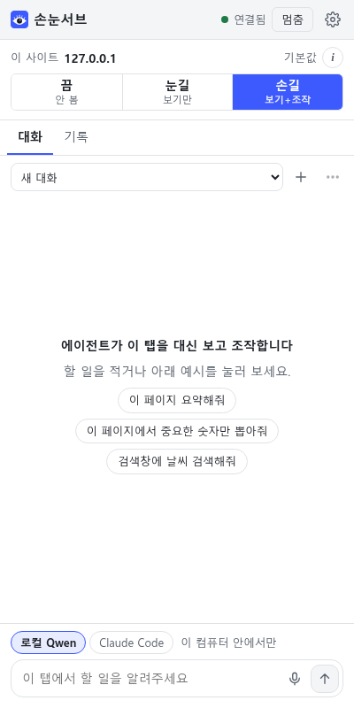
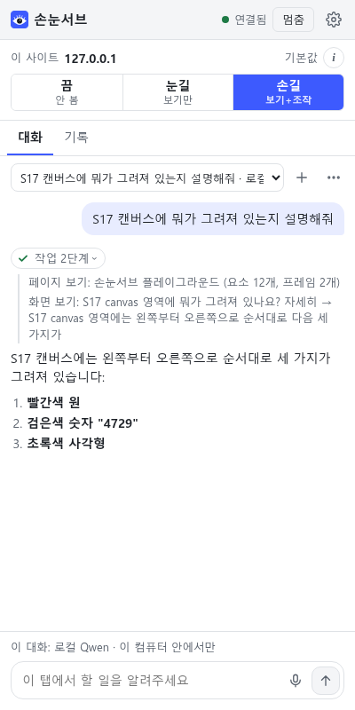
</p>

- **이 사이트**: 지금 탭의 사이트와 권한 (끔·눈길·손길). 아래 6번.
- **세션**: 아래 입력창 위의 **로컬 Qwen / Claude Code** 중 고르고 보냅니다. 대화마다 어느 쪽인지 표시됩니다.
- 할 일을 적거나 **예시**를 누르고 **Enter** (줄바꿈은 Shift+Enter).
- 진행 중에는 지금 하는 단계가 보이고, 끝나면 "✓ 작업 N단계" 한 줄로 접힙니다. 누르면 펼쳐집니다. 실패한 단계가 있으면 빨갛게 펼쳐집니다.
- 실행 중에는 ↑ 자리가 ■ **중지**로 바뀝니다. 헤더의 **멈춤**은 모든 창구의 모든 동작을 즉시 막습니다.
- 일을 시킨 뒤 다른 탭으로 옮겨도 에이전트는 **일을 시킨 탭**에서만 움직입니다 (패널에 "다른 탭에서 작업 중").

**기록** 탭에는 에이전트가 이 브라우저에서 본 것·한 것이 창구(패널·Claude·import)와 상관없이 모두 남습니다.

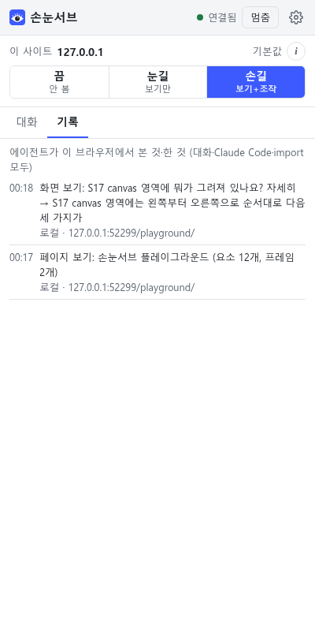

## 5. 잘 되는 지시 예시

테스트 페이지에서 로컬 Qwen 으로 통과한 지시들입니다 ([검증 기록](VERIFICATION.md)). 실제 사이트에서도 같은 모양으로 시키면 됩니다.

| 하고 싶은 것 | 이렇게 |
|---|---|
| 요약 | "이 페이지에 뭐가 있는지 짧게 알려줘" |
| 검색 | "검색창에 대전 날씨 입력하고 검색해줘" |
| 이동해서 읽기 | "두 번째 페이지로 가서 거기 적힌 문장을 그대로 알려줘" |
| 긴 글 끝까지 | "이 페이지 본문 맨 끝 문장이 뭐야?" |
| 여러 번 누르기 | "'눌린 횟수' 버튼을 세 번 눌러줘" |
| 그림·차트 (화면 보기) | "캔버스에 적힌 숫자가 뭐야?" · "맨 왼쪽 동그라미는 무슨 색이야?" |
| 늦게 뜨는 결과 | "불러오기를 누르고, 잠시 뒤 나타나는 확인 버튼까지 눌러줘" |
| 펼쳐지는 메뉴 | "메뉴에 마우스를 올리면 나오는 하위 항목을 눌러줘" |
| 창 닫기 | "창을 열었다가 Esc 키로 닫아줘" |
| 새 탭 | "새 탭 열기 링크를 누르고, 열린 새 탭의 제목을 알려줘" |
| 알림창 | "알림 띄우기 버튼을 누르고, 뜬 알림 내용이 뭐였는지 알려줘" |

- 버튼·칸은 **보이는 이름**으로 말하면 됩니다. 화면 밖에 있어도 이름으로 찾습니다.
- 페이지 안에 "이렇게 하라"는 글이 있어도 에이전트는 따르지 않습니다 (자료로만 봄).

## 6. 사이트 권한 정하기

| 단계 | 에이전트가 할 수 있는 것 |
|---|---|
| **끔** | 아무것도 못 봄. 탭 목록에서도 제목·주소를 가림 |
| **눈길** | 읽고 화면을 볼 수만 있음. 클릭·입력·다른 주소로 이동은 막힘 |
| **손길** | 보고 클릭·입력·이동까지. 되돌리기 어려운 버튼은 허용을 물음 (7번) |

<p>
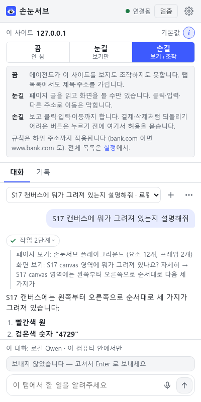
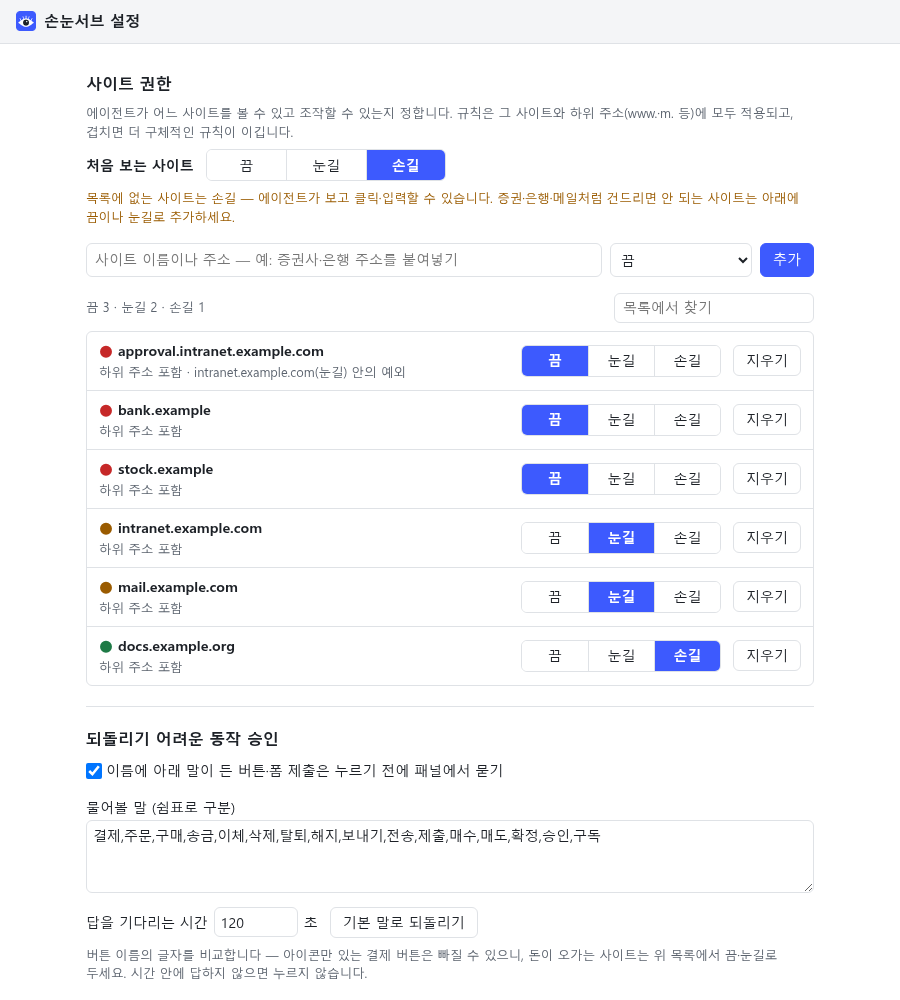
</p>

- **지금 사이트만**: 패널의 끔·눈길·손길을 누릅니다. ⓘ 를 누르면 위 설명이 펼쳐집니다.
- **목록 전체**: 패널 ⚙ (또는 확장 아이콘 우클릭 → 옵션) → **사이트 권한**. 주소를 통째로 붙여넣으면 사이트 이름만 뽑습니다 (`www.` 는 뗌).
- 규칙은 **하위 주소까지** 적용되고, 겹치면 **더 구체적인 규칙**이 이깁니다. 예: `intranet.example.com`=눈길 + `approval.intranet.example.com`=끔.
- 처음 보는 사이트의 기본값은 **손길**입니다. 증권·은행·메일처럼 건드리면 안 되는 사이트는 미리 **끔**이나 **눈길**로 추가해 두세요.
- iframe 은 그 iframe 사이트의 권한을 따로 봅니다 (페이지는 손길이어도 끔인 사이트의 iframe 은 가려짐).

## 7. 승인 카드와 사람에게 넘기기

**승인**: 이름에 결제·주문·구매·송금·이체·삭제·탈퇴·해지·보내기·전송·제출·매수·매도·확정·승인·구독 이 든 버튼을 누르거나 그런 폼을
제출하기 전에, 패널 맨 위에 카드가 뜨고 툴바 아이콘에 **!** 가 붙습니다. **허용**해야 실행되고, 거부하거나 시간 안에 답이 없으면 하지 않습니다.
단어·대기 시간(기본 120초)·끄기는 설정 화면에서 바꿉니다.

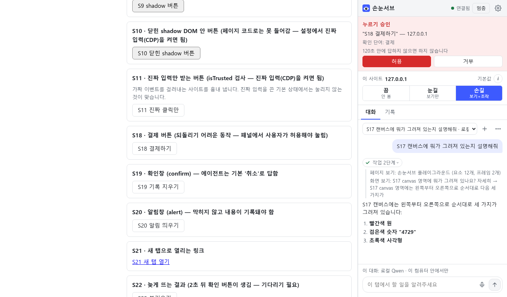

**사람에게 넘기기**: CAPTCHA·로그인·본인 인증처럼 에이전트가 하면 안 되거나 못 하는 일은 에이전트가 패널로 부탁합니다.
직접 한 뒤 **다 했어요**를 누르면 이어서 진행합니다.

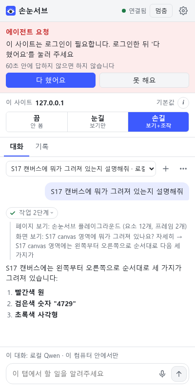

- 승인은 버튼 **이름의 글자**를 비교합니다. 아이콘만 있는 결제 버튼은 빠질 수 있으니, 돈이 오가는 사이트는 끔·눈길로 두는 것이 안전합니다.
- 비밀번호 칸은 에이전트가 입력하지 않습니다.

## 8. 음성 입력

입력창의 🎤 를 누르고 말합니다. **말을 멈추면 알아서 끝나고** 글로 바뀝니다.

<p>
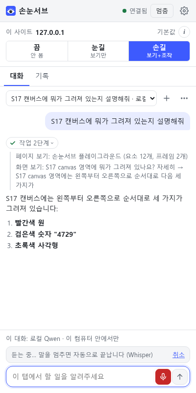
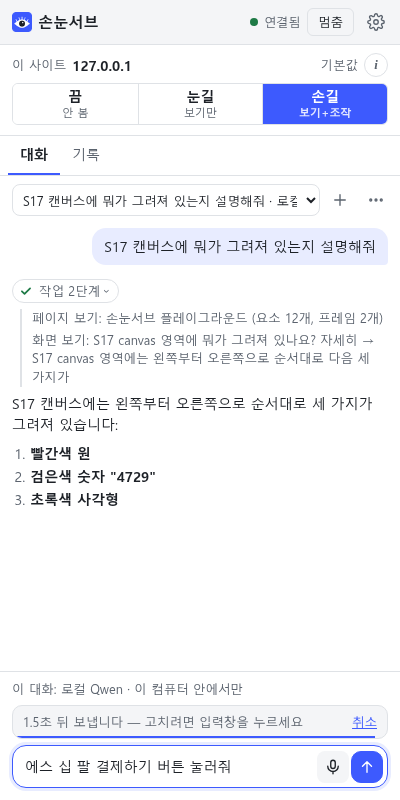
</p>

설정 화면 → **음성 입력**에서 고릅니다.

| 받아적는 엔진 | 특징 |
|---|---|
| **Google 음성 인식** (기본) | Chrome 내장, 무료·키 없음. 인터넷 필요, 내 말이 Google 로 감 (페이지 내용은 안 감) |
| **Whisper** | 이 컴퓨터 안에서. 폐쇄망에서도 됨. 음성 서버를 켜야 함 ↓ |

```bash
python -m pip install -e .[stt]          # faster-whisper
python tools/stt_server.py               # :8013, GPU 약 1.5GB (--device cpu 도 됨)
```

| 말을 멈춘 뒤 | 동작 |
|---|---|
| **잠깐 보여 주고 보내기** (기본) | 받아적은 글을 1.5초 보여 주고 보냄. 그사이 입력창을 누르거나 Esc 면 보내지 않음 (잘못 들은 말로 조작하지 않게) |
| **바로 보내기** | 곧바로 보냄 |
| **입력창에만** | 넣기만 하고 Enter 는 직접 |

- **처음 한 번 마이크 허용**: 사이드 패널은 Chrome 이 허용 창을 띄우지 못합니다. 🎤 를 누르면 "마이크 허용하기"가 뜨고, 누르면 설정 화면에서 허용합니다.
- 녹음과 받아적은 글은 저장하지 않습니다 (보낸 글만 대화에 남음).

## 9. 그 밖의 기능

- **진짜 입력 (CDP)**: 설정 화면에서 켭니다. 가짜 이벤트를 거르는 사이트, 닫힌 shadow DOM 안 버튼을 누를 수 있게 됩니다.
  쓰는 동안 Chrome 위에 "디버깅 중" 띠가 뜨고, 20초 쓰지 않으면 떼어 냅니다.
- **스크립트로 내보내기**: 패널의 **⋯ → 스크립트로 내려받기**, 또는 `sonnun export [대화 id] --format sonnun|playwright`.
  성공한 조작만 골라 요소 **이름**으로 다시 실행합니다. `sonnun` 형식은 내 Chrome 에서 권한·승인을 그대로 거치고, `playwright` 형식은 손눈서브 없이 단독으로 돕니다.
- **플레이그라운드**: `http://127.0.0.1:8771/playground/` — 시나리오 24개. 직접 시켜 보거나 `sonnun demo` 로 차례로 실행해 봅니다.

  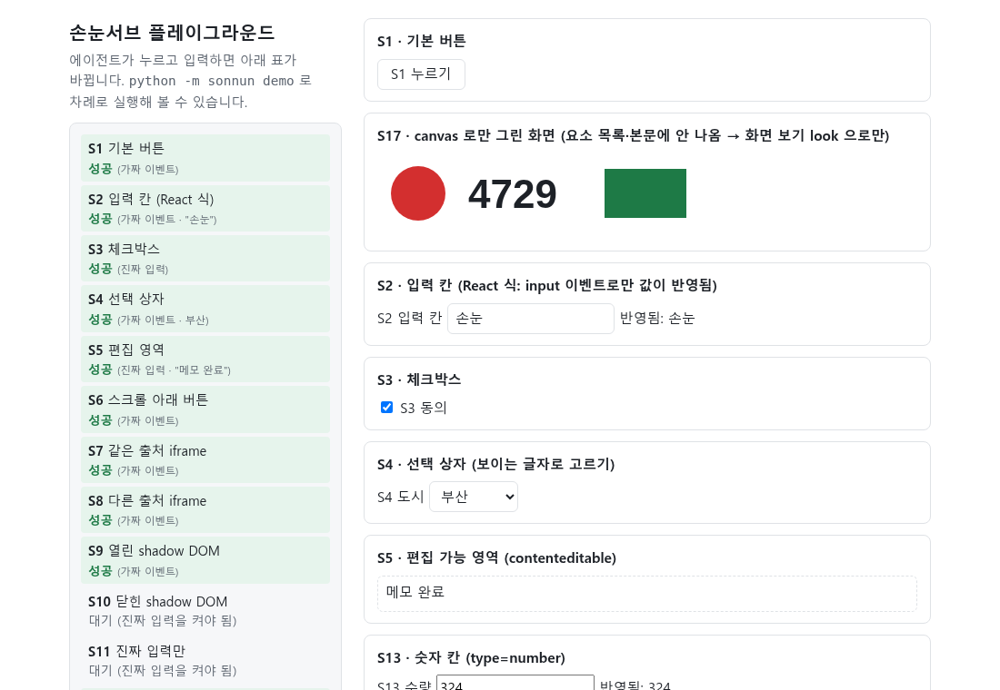

- **CLI**: `sonnun run "이 페이지 요약해줘" [--backend claude]` — 패널 대화 목록에도 보입니다.
- **import**: `from sonnun.client import Sonnun; b = Sonnun(); b.get_page(); b.click(ref="12")`
- **MCP**: `python -m sonnun.mcp_bridge --url http://127.0.0.1:8771` 를 MCP 클라이언트에 stdio 서버로 등록하면 다른 에이전트가 도구로 씁니다.

## 10. 문제 해결

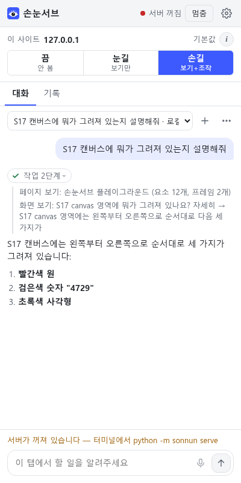

| 증상 | 할 일 |
|---|---|
| 패널 오른쪽 위 🔴 **서버 꺼짐** | 터미널에서 `sonnun serve`. 켰는데도 그대로면 Chrome 주소창에 `http://127.0.0.1:8771/api/status` 를 열어 보기 — JSON 이 보이면 설정 화면의 서버 주소를 확인 |
| 🟡 **확장 연결 중**에서 멈춤 | `chrome://extensions` 에서 손눈서브 **새로고침(↻)** |
| 세션 선택지가 잠김 | 이유 문구 그대로 — 로컬은 LLM 서버 꺼짐·모델 이름 다름 (`SONNUN_LLM_MODEL`), Claude 는 `claude` 설치·로그인 |
| "권한이라 볼(조작할) 수 없음" 답 | 패널에서 그 사이트를 눈길·손길로 |
| 눌렀다는데 페이지가 반응 없음 | 가짜 이벤트를 거르는 사이트 → 설정에서 **진짜 입력** 켜기 |
| "다른 대화가 브라우저를 쓰는 중" | 브라우저는 하나라 한 번에 한 대화만 — 끝나거나 **중지**한 뒤 |
| 🎤 "마이크를 쓸 수 없습니다" | **마이크 허용하기** → 설정 화면에서 허용 |
| 🎤 "Google 음성 인식에 닿지 못했습니다" | 인터넷이 없음 → 설정에서 Whisper 로 |
| 🎤 "음성 서버가 꺼져 있음" | `python tools/stt_server.py` |
| WSL 서버 + Windows Chrome | WSL `networkingMode=mirrored` 에서 127.0.0.1 로 붙는 것을 확인했습니다 (다른 모드는 확인 안 함) |
| 확장 파일을 바꿨는데 그대로 | 확장 **새로고침(↻)**, 서버 쪽을 바꿨으면 `sonnun serve` 다시 |
